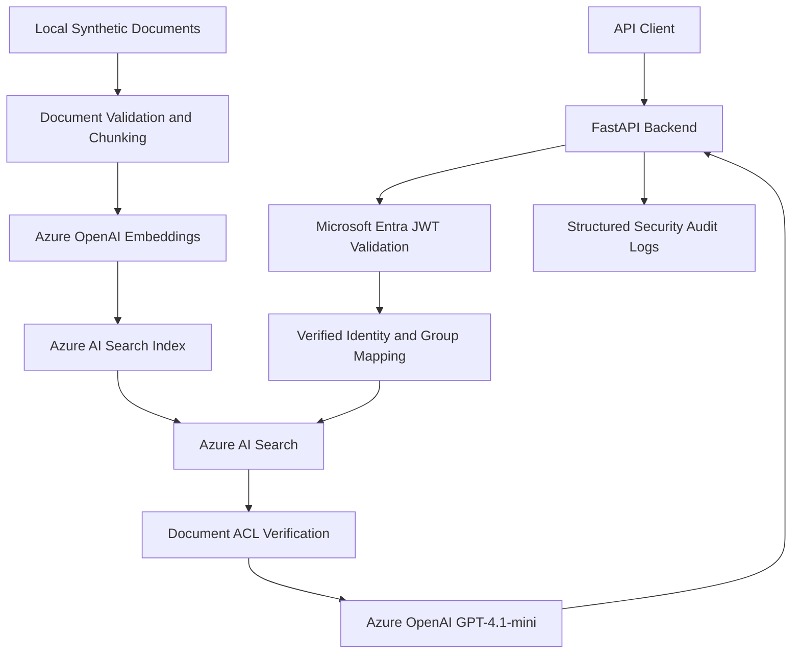

# Secure Enterprise RAG

**An Azure-based AI Security Architecture portfolio project.**

This project demonstrates how to design and secure an enterprise Retrieval-Augmented Generation (RAG) application using Microsoft Azure.

It focuses on identity-aware retrieval, document-level authorisation, prompt-injection risk, secure API design, audit logging and AI threat modelling.

## Technology Stack

- Python and FastAPI
- Microsoft Entra ID and OAuth 2.0
- Azure OpenAI (GPT-4.1-mini)
- Azure AI Search
- Terraform
- Pytest

## Security Controls

- Microsoft Entra JWT authentication and validation
- Role and group-based document access control
- Authorisation filtering before and after retrieval
- Approved document metadata and access policies
- Secure error handling and structured audit logging
- Prompt-injection testing and content-filter handling

## Automated Security Testing

**69 tests passed, 0 failed.**

The tests cover authentication, authorisation, retrieval security, audit logging, API validation and selected AI security scenarios.

## Threat Modelling

A STRIDE-based threat model documents trust boundaries, attack scenarios, mitigations and 13 assessed security risks.

See [Threat Model](docs/threat-model.md).

## Known Limitations

This is a development reference implementation, not a production-ready service.

Outstanding work includes document integrity protection, privileged index-write controls, broader prompt-injection testing, production network hardening and live Azure identity integration testing.

## Project Documentation

- [Backend Setup](app/backend/README.md)
- [Threat Model](docs/threat-model.md)
- [Monitoring and Audit](docs/monitoring-and-audit.md)

## System Architecture

### Security Design

The architecture separates user authentication from Azure workload authentication.

Documents are checked against an approved access policy during ingestion. Retrieval applies group-based filtering and verifies document permissions again before passing retrieved content to the language model.

Retrieved content is treated as untrusted. The system includes selected prompt-injection tests, audit logging and fail-closed authorisation controls.

The current implementation uses local synthetic documents for ingestion. Azure Blob Storage is provisioned but is not the active ingestion source.
