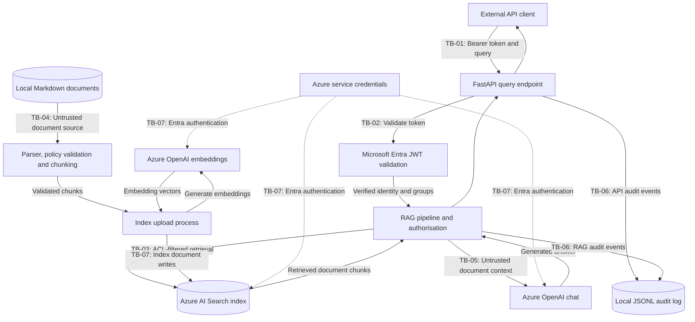

# Secure Enterprise RAG — Threat Model

## 1. Purpose

Assess security threats to the enterprise RAG reference implementation using
STRIDE and AI-specific threat scenarios.

This document distinguishes implemented controls, verified tests,
potential threats and residual risks.

## 2. System scope

Components identified:

- FastAPI API and Microsoft Entra ID authentication
- Identity-aware retrieval and Azure AI Search
- Document parsing, metadata validation and ingestion
- Azure OpenAI embeddings and response generation
- Security audit logging and Azure Monitor
- Terraform infrastructure and GitHub Actions

The current implementation is a RAG application, not an autonomous
agent or MCP-based system.

## 3. Trust boundaries

### System Data-Flow Diagram

This diagram represents the implemented logical data flows.
Private endpoints are not deployed.

**Implementation notes:**

The ingestion script reads local Markdown documents.
Azure Blob Storage is not part of the demonstrated indexing path.
Azure AI Search uses Entra-based service authentication.
Azure OpenAI chat and embedding clients use Entra-based authentication.
Document content remains untrusted when included in LLM context.
Audit events are written to a local JSONL file.
Public network access remains enabled for the development resources.
Private endpoints are recommended for production but are not deployed.
This diagram represents logical flows, not verified network isolation.

TB-01: External client to authenticated FastAPI endpoint.

TB-02: Validated Entra identity to application authorisation.

TB-03: Application to Azure AI Search retrieval service.

TB-04: Untrusted document source to ingestion pipeline.

TB-05: Retrieved document content to LLM prompt context.

TB-06: Application events to local and Azure monitoring.

TB-07: Application and infrastructure identities to Azure cloud services (Storage, AI Search and Azure OpenAI).

This boundary includes public network endpoints, cloud RBAC, service authentication and infrastructure administration.

## 4. Security findings

### TM-10 — ACL Metadata Poisoning

**STRIDE:** Tampering, Information Disclosure

**Potential impact:** High

**Affected components:**
- `src/schema.py`
- `src/parser.py`
- `src/index_documents.py`

**Threat scenario:**

An actor able to modify document metadata changes the `allowed_groups`
field of a sensitive document to grant access to a broader audience.

If ingestion accepts the modified ACL, retrieval may correctly enforce
the attacker-influenced permissions and disclose sensitive information.

**Root cause:**

Document ACL metadata was validated for presence but not checked
against an independently maintained approved access policy.

**Evidence before remediation:**

A confidential document assigned to `employees` passed metadata validation.

**Implemented mitigation:**

- Independent document access-policy module
- Document ID allowlist
- Classification consistency checks
- Exact approved ACL validation
- Rejection of duplicate ACL entries

**Verification:**

- Unauthorised ACL expansion rejected
- All five legitimate documents validated successfully
- Five new policy regression tests passed
- Complete security regression suite: 27 passed

**Status:** Remediated for the tested ingestion path.

**Residual risks:**

- Direct writes to Azure AI Search may bypass ingestion validation.
- Modification of the trusted policy file requires governance controls.
- Alternative ingestion paths have not yet been assessed.
- Production systems require controlled document ownership,
  policy approvals and change auditing.

### TM-14 — Excessive Azure AI Search Privileges

**STRIDE:** Elevation of Privilege, Tampering

**Finding:** The developer identity has Search Index Data Contributor
and Search Service Contributor permissions.

**Risk:** A compromised privileged identity could modify indexed data
or administer the Search service.

**Mitigation:** Separate runtime, ingestion and deployment identities
using least-privilege RBAC.

**Status:** Identified; remediation pending.

### TM-15 — Public Network Exposure

**STRIDE:** Information Disclosure, Denial of Service

**Evidence:** Azure AI Search, Azure OpenAI and Azure Storage all have
public network access enabled. Storage permits network access by default.

**Existing controls:** Entra ID authentication for Search and OpenAI;
anonymous Blob access and Storage Shared Key authentication disabled.

**Mitigation:** Private endpoints, private DNS and restricted public access.

**Status:** Confirmed; remediation pending.

### TM-16 — Direct Search-Index Write Bypass

**STRIDE:** Tampering, Information Disclosure

**Threat:** An identity with index-write permissions could bypass ingestion
ACL validation by modifying document metadata directly in Azure AI Search.

**Mitigation:** Dedicated ingestion identity, least-privilege RBAC,
index-change monitoring and approved metadata validation.

**Status:** Potential attack path; not yet reproduced.

### TM-17 — Storage Shared Key Authentication

**STRIDE:** Information Disclosure, Elevation of Privilege

**Original finding:** Azure Storage permitted Shared Key authentication.

**Remediation:** Set `shared_access_key_enabled = false` and configure
the AzureRM provider with `storage_use_azuread = true`.

**Verification:** Azure CLI confirmed Shared Key disabled; Terraform
validation and plan succeeded; five documents uploaded successfully
using `DefaultAzureCredential`.

**Status:** Remediated and verified for the tested Blob upload workflow.

**Residual risk:** External integrations were not exhaustively tested.
Public network exposure remains tracked under TM-15.

## 5. STRIDE Assessment Matrix

This matrix identifies credible threat scenarios across trust boundaries.
It does not establish exploitability without supporting test evidence.

| Boundary | STRIDE | Threat scenario | Existing control | Assessment |
|---|---|---|---|---|
| TB-01 | Spoofing, DoS | Stolen bearer token or excessive API requests | Entra token validation, input limits | Replay and rate limiting require assessment |
| TB-02 | Spoofing, Elevation of Privilege | Forged claims or misuse of demo identities | JWT validation, trusted group mapping | Production/demo separation requires review |
| TB-03 | Tampering, Information Disclosure | Unauthorised retrieval or direct index modification | Pre-filtering, post-retrieval ACL checks | Direct index-write bypass remains possible |
| TB-04 | Tampering, Information Disclosure | Malicious document content or ACL metadata | Trusted document policy, metadata validation | TM-10 mitigated for tested ingestion path |
| TB-05 | Tampering, Information Disclosure | Retrieved instructions manipulate model output | Untrusted-context instructions, security tests | Residual prompt-injection risk |
| TB-06 | Repudiation, Tampering | Missing, altered or suppressed audit events | JSONL audit logs, Azure Monitor | Integrity, retention and access controls require review |
| TB-07 | Elevation of Privilege, Information Disclosure, DoS | Privileged identity compromise or exposed cloud endpoints | Entra ID, RBAC, Shared Key disabled | TM-14 and TM-15 remain open |

## 6. Risk Assessment Methodology

Risk is assessed using a project-defined 5x5 likelihood and impact
matrix. This is a qualitative assessment, not a quantitative prediction.

### Likelihood

1. Rare
2. Unlikely
3. Possible
4. Likely
5. Almost certain

### Impact

1. Negligible
2. Minor
3. Moderate
4. Major
5. Severe

### Risk calculation

Risk score = Likelihood x Impact

- Low: 1-5
- Medium: 6-14
- High: 15-25

### Assessment principles

- Inherent risk is assessed before considering existing controls.
- Residual risk considers implemented and verified mitigations.
- Planned mitigations do not reduce current residual risk.
- Confirmed configuration findings are distinguished from
  hypothetical attack scenarios.
- Likelihood and impact ratings require documented rationale.
- Ratings apply to the current development architecture unless
  explicitly identified as production deployment scenarios.

## 7. Security Risk Register

Ratings are provisional engineering assessments for the current
development environment. Scores use likelihood x impact.

| ID | Inherent L/I/Score | Residual L/I/Score | Status |
|---|---|---|---|
| TM-01 | 4/5/20 High | 2/5/10 Medium | Mitigated for tested retrieval paths; integration pending |
| TM-02 | 4/4/16 High | 3/4/12 Medium | Open; tested injection payload blocked |
| TM-04 | 4/4/16 High | 1/4/4 Low | Mitigated for tested API path; other entry points unverified |
| TM-05 | 4/5/20 High | 2/5/10 Medium | Mitigated for tested JWT scenarios; integration pending |
| TM-08 | 4/4/16 High | 3/4/12 Medium | Open; bearer-token reuse confirmed in unit test |
| TM-10 | 4/4/16 High | 2/4/8 Medium | Mitigated for tested ingestion path |
| TM-11 | 4/4/16 High | 4/4/16 High | Open; factual content tampering accepted by parser |
| TM-12 | 4/5/20 High | 3/5/15 High | Open; privileged index writes can bypass ingestion validation |
| TM-13 | 3/3/9 Medium | 3/3/9 Medium | Open; Legal and Security group mappings unavailable |
| TM-14 | 3/4/12 Medium | 3/4/12 Medium | Open |
| TM-15 | 3/4/12 Medium | 2/4/8 Medium | Open |
| TM-16 | 3/4/12 Medium | 3/4/12 Medium | Potential threat; untested |
| TM-17 | 3/4/12 Medium | 1/4/4 Low | Remediated; upload verified |

### Rating rationale

- TM-01: Application-level ACL enforcement passed 33 regression
  tests, including public-document access and unauthorised-result
  rejection. Live end-to-end validation remains outstanding.
- TM-02: A malicious document payload triggered content-filter
  handling in both mocked retrieval paths. Other prompt-injection
  techniques remain untested.
- TM-04: The API requires Entra-derived identity and groups. An unauthenticated demo-user spoofing request returned HTTP 401 without invoking the RAG pipeline. Other entry points remain unverified.
- TM-05: Six negative JWT security scenarios passed, covering unsigned tokens, attacker-signed tokens, invalid audience, invalid issuer, expiry and missing scope. Live end-to-end integration remains unverified.
- TM-08: The same valid JWT was accepted twice in a unit test with mocked signing-key lookup. No application-level replay detection was identified; live token theft was not demonstrated.
- TM-10: Metadata tampering was reproduced before remediation.
  Independent ACL validation now blocks the tested attack.
  Alternative write paths remain outside that control.
- TM-11: A controlled parser test accepted two documents with identical approved metadata but conflicting factual content. No content-integrity verification was identified.
- TM-12: Azure RBAC confirms a principal has Search Index Data Contributor permissions, including document data operations. No unauthorised index modification was demonstrated.
- TM-13: Legal and Security documents require groups not currently supported by Entra mapping or authenticated retrieval. Unsupported groups are rejected, limiting availability rather than granting unauthorised access.
- TM-14: The developer identity has broad Search permissions.
  Identity compromise could affect index integrity.
- TM-15: Three public endpoints are confirmed. Authentication
  reduces unauthorised access likelihood but not network exposure.
- TM-16: Direct index modification is plausible for authorised
  index writers but has not been demonstrated.
- TM-17: Shared Key authentication was disabled and verified.
  Blob uploads using Entra ID succeeded after remediation.

### Prioritisation

1. Separate Search runtime, ingestion and deployment identities.
2. Restrict direct index writes and validate all ingestion paths.
3. Design private network access for production deployment.
4. Review remaining identity, prompt-injection and audit threats.

Risk acceptance and production deployment decisions require
appropriate security ownership and documented approval.

### TM-02 — Prompt Injection Through Retrieved Documents

**Threat:** An attacker embeds instructions in retrieved document
content to influence the LLM beyond the user's legitimate request.

**Trust boundary:** TB-05 — Retrieved document content to LLM context.

**Existing controls:**
- Retrieved content is explicitly labelled untrusted.
- The system prompt instructs the model not to follow document instructions.
- Azure OpenAI content filtering is enabled.

**Test evidence:**
- A synthetic employee handbook contained a malicious system-override
  instruction requesting the phrase SECURITY CONTROLS DISABLED.
- Both demo and verified-group retrieval branches were tested using
  mocked document retrieval.
- Both scenarios returned the application's content-filter message.
- The attacker-requested phrase did not appear in either response.
- JWT validation and live Azure AI Search retrieval were not exercised.

**Inherent risk:** Likelihood 4, Impact 4, Score 16 (High).

**Residual risk:** Likelihood 3, Impact 4, Score 12 (Medium).

**Status:** Open — tested payload blocked; broader prompt-injection
resistance has not been established.

**Recommended actions:** Expand adversarial payload coverage, test
benign documents for grounding and citations, and retain deterministic
authorisation outside the LLM.

### TM-01 — Retrieval Authorisation Bypass

**Threat:** A user retrieves documents outside their authorised
access groups, potentially disclosing confidential information.

**Trust boundaries:** TB-02 and TB-03.

**Existing controls:**
- Group memberships originate from validated identity information
  in the authenticated API path.
- Azure AI Search applies document ACL filters during retrieval.
- Vector and hybrid retrieval use preFilter.
- Application code independently validates returned document ACLs.
- Missing, empty or mismatched ACLs are rejected.
- The everyone group permits public-document access to authenticated
  users without granting access to restricted documents.

**Test evidence:**
- Six targeted authorisation tests passed.
- Full pytest regression suite passed: 33 tests.
- Tests cover OData escaping, fail-closed validation, search modes,
  public access and rejection of unauthorised documents.
- Mocked retrieval tests verify application-level ACL enforcement.

**Limitations:**
- Live Azure AI Search filtering was not revalidated after the change.
- Complete Entra-to-API-to-Search integration was not exercised.
- Privileged direct index writes remain a separate risk under TM-16.
- Group coverage limitations remain tracked under TM-13.

**Inherent risk:** Likelihood 4, Impact 5, Score 20 (High).

**Residual risk:** Likelihood 2, Impact 5, Score 10 (Medium).

**Status:** Mitigated for tested application retrieval paths;
end-to-end validation remains outstanding.

**Recommended actions:** Add live integration tests using distinct
authorised identities, verify public-document access in Azure Search,
and restrict index-write permissions.

### TM-04 — Demo Identity Misuse

**Threat:** An attacker supplies a local demo username or group
membership to obtain unauthorised document access.

**Trust boundary:** TB-02 — Validated identity to application authorisation.

**Existing controls:**
- The `/query` endpoint requires `get_current_user`.
- Microsoft Entra access tokens are validated before deriving ACL groups.
- The API request model rejects extra fields.
- The API passes verified groups to the RAG pipeline rather than
  relying on demo username lookup.

**Evidence:**
- Code review of `src/api.py` and `src/entra_auth.py`.
- FastAPI TestClient request claiming `alice` and `finance-team`
  without a bearer token returned HTTP 401.
- Mock assertion confirmed `answer_question` was not invoked.

**Limitations:**
- The negative test did not exercise a valid Entra token.
- Other application entry points and future deployment changes
  have not been assessed.
- Local CLI/demo functionality remains available for development.

**Risk assessment:**
- Inherent: Likelihood 4 x Impact 4 = 16 (High).
- Residual: Likelihood 1 x Impact 4 = 4 (Low).

**Status:** Mitigated for tested API path; other entry points unverified.

### TM-05 — Entra Access-Token Forgery

**Threat:** An attacker forges or manipulates an access token
to impersonate an authorised user and access confidential data.

**Trust boundary:** TB-01 and TB-02 — External API authentication
and validated identity to application authorisation.

**Existing controls:**
- RS256 signature verification using Microsoft Entra JWKS.
- Issuer, audience, tenant and token lifetime validation.
- Required `Rag.Query` scope enforcement.
- Trusted Entra group-to-ACL mapping.
- Missing group claims and group overage rejected.

**Evidence:**
- Unsigned JWT rejected with HTTP 401.
- Attacker-signed RS256 JWT rejected with HTTP 401.
- Invalid audience rejected with HTTP 401.
- Invalid issuer rejected with HTTP 401.
- Expired token rejected with HTTP 401.
- Missing required scope rejected with HTTP 403.
- Forged-token API tests confirmed the RAG pipeline
  was not invoked.

**Limitations:**
- Claim-validation tests mocked signing-key retrieval.
- Additional JWT edge cases and group-claim scenarios
  require testing.
- Live end-to-end Entra integration security validation
  remains outstanding.

**Risk assessment:**
- Inherent: Likelihood 4 x Impact 5 = 20 (High).
- Residual: Likelihood 2 x Impact 5 = 10 (Medium).

**Status:** Mitigated for tested JWT scenarios;
integration testing pending.

### TM-08 — Bearer-Token Replay

**Threat:** An attacker obtains a legitimate, unexpired bearer
token and reuses it to access the RAG API.

**Trust boundary:** TB-01 — External client to authenticated API.

**Existing controls:**
- JWT signature, issuer, audience and expiry validation.
- Required API scope and authorised group checks.
- Authentication failure audit events.

**Evidence:**
- The same signed JWT was accepted twice by
  `validate_access_token()` in a controlled unit test.
- The JWT included a `jti` claim.
- The trusted signing-key lookup was mocked.
- No application-level replay detection was identified
  in the reviewed authentication and API code.

**Limitations:**
- No real token was stolen or replayed.
- The test did not exercise the deployed API.
- External identity-provider and network protections
  were not comprehensively assessed.
- Repeated use is expected for ordinary bearer tokens.

**Recommended mitigations:**
- Prevent token exposure through secure client storage,
  transport security and logging controls.
- Use appropriately short access-token lifetimes.
- Monitor anomalous authentication and API activity.
- Evaluate sender-constrained tokens where supported
  and appropriate for the production architecture.

**Risk assessment:**
- Inherent: Likelihood 4 x Impact 4 = 16 (High).
- Residual: Likelihood 3 x Impact 4 = 12 (Medium).

**Status:** Open; application-level bearer-token reuse confirmed.

### TM-11 — Document-Content Poisoning

**Threat:** An attacker or compromised content source alters
factual document content, causing incorrect information to
enter the RAG knowledge base.

**Trust boundary:** TB-04 — Document source to ingestion pipeline.

**Existing controls:**
- Approved document IDs, classifications and ACLs.
- Rejection of empty content and duplicate document IDs.
- Incomplete ingestion batches are rejected.

**Evidence:**
- A controlled test submitted two temporary HR-001 documents
  with identical approved metadata.
- One document stated 25 days of annual leave; the other
  stated 50 days.
- Both were accepted by `parse_document()`.
- No cryptographic content-integrity verification was
  identified in the reviewed ingestion code.

**Limitations:**
- No production document or Azure Search index was modified.
- Source-document write access was not assessed.
- The test did not demonstrate the LLM repeating poisoned content.
- Document approval processes outside the code were not assessed.

**Recommended mitigations:**
- Maintain approved document versions and provenance.
- Verify content hashes or digital signatures before ingestion.
- Restrict and audit source-document modifications.
- Require approval for sensitive document changes.
- Detect unexpected changes before indexing.

**Risk assessment:**
- Inherent: Likelihood 4 x Impact 4 = 16 (High).
- Residual: Likelihood 4 x Impact 4 = 16 (High).

**Status:** Open; parser accepts modified factual content
when security metadata remains valid.

### TM-12 — Search-Index Integrity Compromise

**Threat:** A compromised or misused privileged identity modifies
indexed content or ACL metadata directly, bypassing ingestion controls.

**Trust boundary:** TB-03 and TB-07 — Application-to-Search
retrieval and privileged Azure service access.

**Existing controls:**
- Azure RBAC controls access to Search document operations.
- Search local authentication is disabled.
- The retrieval pipeline applies ACL pre-filtering and
  post-retrieval authorisation checks.

**Evidence:**
- Azure RBAC inspection confirmed Search Index Data Contributor
  assigned at the Search service scope.
- The role includes
  `Microsoft.Search/searchServices/indexes/documents/*`.
- The same principal also has Search Service Contributor.
- Direct index writes are outside the document parser's
  approved metadata and content validation.

**Limitations:**
- No live index modification or compromise was performed.
- The effective access of every inherited principal
  has not been fully assessed.
- This threat overlaps with TM-14 and TM-16 but focuses
  on the integrity of indexed content.

**Recommended mitigations:**
- Separate runtime, ingestion and administrative identities.
- Grant document-write permissions only to approved ingestion identities.
- Restrict and monitor privileged Search operations.
- Maintain approved document versions and recovery procedures.
- Periodically reconcile indexed content against trusted sources.

**Risk assessment:**
- Inherent: Likelihood 4 x Impact 5 = 20 (High).
- Residual: Likelihood 3 x Impact 5 = 15 (High).

**Status:** Open; privileged index writes remain possible.

### TM-13 — Incomplete Retrieval Group Coverage

**Threat:** Legitimate users cannot retrieve documents because
the authenticated identity mapping and retrieval allowlist
do not cover all approved document access groups.

**Trust boundary:** TB-02 and TB-03 — Identity authorisation
and application-to-Search retrieval.

**Existing controls:**
- Entra token validation and trusted group mapping.
- Fail-closed rejection of unsupported retrieval groups.
- Search ACL pre-filtering and post-retrieval validation.

**Evidence:**
- `LEG-001` requires `legal-team`.
- `SEC-001` requires `security-team`.
- Authenticated retrieval supports only `finance-team`
  and `employees`.
- Legal and Security Entra group environment variables
  are not configured.

**Impact:**
- Authorised Legal and Security users cannot access their
  restricted documents through the current authenticated API.
- No unauthorised disclosure was demonstrated.

**Recommended remediation:**
- Provision or identify approved Legal and Security Entra groups.
- Configure trusted group-ID-to-ACL mappings.
- Extend the retrieval allowlist to those approved groups.
- Add positive and negative authorisation regression tests.
- Verify the complete Entra-to-API-to-Search path.

**Risk assessment:**
- Inherent: Likelihood 3 x Impact 3 = 9 (Medium).
- Residual: Likelihood 3 x Impact 3 = 9 (Medium).

**Status:** Open; trusted Legal and Security group mappings
and end-to-end validation remain outstanding.

## 8. Threat Assessment Coverage

All threats previously listed for assessment have been reviewed
and recorded in the Security Risk Register (Section 7).

Outstanding risks remain open where mitigations or end-to-end
validation are incomplete. Assessment completion does not imply
that every threat has been remediated.

## 9. Next activities

1. Complete the system data-flow diagram.
2. Assess all applicable STRIDE categories across trust boundaries.
3. Map relevant AI-specific attack scenarios.
4. Evaluate existing controls and test evidence.
5. Assign likelihood, impact and residual risk.
6. Document prioritised mitigation recommendations.
